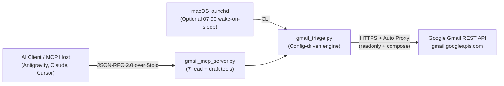

# Why Local Stdio MCP? Architecture & Design Notes

This guide explains **why `gmail-personal-mcp` uses a local Stdio MCP server** instead of hosted remote MCP endpoints or standalone shell scripts, and gives a 60-second overview of how MCP works under the hood.

---

## 1. Why Not Google's Hosted Remote Gmail MCP?

Google offers a hosted Gmail Remote MCP endpoint (`https://gmailmcp.googleapis.com/mcp/v1`) over Streamable HTTP. While convenient for enrolled enterprise Google Workspace domains, personal `@gmail.com` users and CLI agents routinely hit three practical blockers:

1. **`403 Forbidden` on personal `@gmail.com` accounts**: Hosted Workspace MCP endpoints are gated behind Google's Developer Preview Program and Workspace domain policies. Even after completing OAuth login, `tools/list` frequently returns `403 Forbidden: rejected by transport`.
2. **CLI OAuth friction (`401 Unauthorized`)**: Terminal-based AI agents often lack an interactive browser OAuth flow for remote MCP servers, requiring manual token handoffs or desktop-app workarounds.
3. **High token overhead & no custom noise filtering**: Generic remote endpoints expose low-level atomic calls; scanning 80 recent threads requires many round trips and burns context tokens on newsletters, forwarding banners, and bulk notices.

### Hosted Remote MCP vs. Local Stdio MCP

| Dimension | Hosted Remote MCP (`gmailmcp.googleapis.com`) | Local Stdio MCP (`gmail_mcp_server.py`) |
| --- | --- | --- |
| **Personal `@gmail.com` support** | Restricted (often `403 Forbidden`) | **100% reliable** via standard `gmail.googleapis.com` |
| **CLI & multi-client compatibility** | Requires remote OAuth UI support | **Plug-and-play** in Antigravity, Claude Desktop, Cursor |
| **Permission boundary** | Controlled server-side | **Hard-coded in local source**: `gmail.readonly` + `gmail.compose` only (no send/delete code) |
| **Triage efficiency** | Many round trips, high token usage | Single `daily_triage_brief` call strips forwarding banners, catches read-but-unreplied threads, and drops bulk noise |
| **Local HTTP proxy support** | Depends on host app networking | Automatically reads environment & OS proxies (e.g., Clash) via `AuthorizedSession` |

---

## 2. Architecture: Local MCP vs. Standalone Scripts

Both the MCP server (`gmail_mcp_server.py`) and the optional macOS `launchd` runner (`scripts/run_daily_check.sh`) share the exact same local engine (`gmail_triage.py`), `config.json`, and `token.json`:



### Why Use Both Channels?

- **Local MCP (`gmail_mcp_server.py`)** is best for interactive AI triage and drafting:
  - **Available in every workspace**: Registered once globally in `mcp_config.json`, so your AI assistant always has typed Gmail tools with strict JSON Schemas.
  - **Zero shell-sandbox friction**: Runs as a trusted local tool channel instead of asking for shell network permissions on every command.
  - **Fine-grained workflow**: Combine `daily_triage_brief`, `get_thread`, `list_drafts`, and `create_draft` in one conversation.
- **CLI + `launchd` (`gmail_triage.py` + `scripts/run_daily_check.sh`)** is best for unattended morning digests:
  - Runs automatically after your Mac wakes from sleep, writes `reports/YYYY-MM-DD_digest.md`, and posts a macOS notification without needing an AI app open.

---

## 3. How Stdio MCP Works (in 60 Seconds)

**MCP (Model Context Protocol)** is an open standard that lets any AI client connect to external tools through a single protocol — much like USB-C for AI tools or LSP for code editors.

- **MCP Host**: Your AI app (Antigravity, Claude Desktop, Cursor).
- **MCP Server**: A lightweight local subprocess (`gmail_mcp_server.py`) launched by the Host.
- **Stdio Transport**: No open TCP ports and no cloud relay. The Host and Server exchange newline-delimited **JSON-RPC 2.0** messages over `stdin` and `stdout` (all logs go to `stderr` so `stdout` stays clean).

A real tool call looks remarkably simple:

```json
// Host -> gmail_mcp_server.py (stdin)
{"jsonrpc":"2.0","id":2,"method":"tools/call","params":{"name":"search_threads","arguments":{"query":"reimbursement newer_than:7d","max_results":5}}}

// gmail_mcp_server.py -> Host (stdout)
{"jsonrpc":"2.0","id":2,"result":{"content":[{"type":"text","text":"{\"count\":2,\"threads\":[...]}"}],"isError":false}}
```

### Three Concepts Often Confused

1. **Function Calling**: The LLM's native ability to decide *which* structured tool call to request.
2. **MCP**: The standard *wiring protocol* (`tools/list`, `tools/call`) connecting the AI client to local or remote tools.
3. **Prompts / Rules**: Your personal workflow instructions (e.g., priority ordering, tone, reply templates) telling the assistant *how* to combine those tools.

---

## 4. Built-In Reliability & Safety Details

- **Minimal dependencies**: Only 3 lightweight Python packages (`google-auth`, `google-auth-oauthlib`, `requests`). No heavy MCP SDK or `httplib2`.
- **Quota-friendly fetching**: Uses `format=metadata` first and only fetches full bodies for top-priority items, with exponential backoff on HTTP `429` / `403 rateLimitExceeded`.
- **Draft-only by construction**: OAuth scopes are strictly `gmail.readonly` and `gmail.compose`. Neither `messages.send` nor `messages.delete`/`trash` exists anywhere in the codebase.
- **PII isolation**: `credentials.json`, `token.json`, `config.json`, `gmail_filters.xml`, and `reports/` are all gitignored by default, and credential files are written with `0600` permissions.
